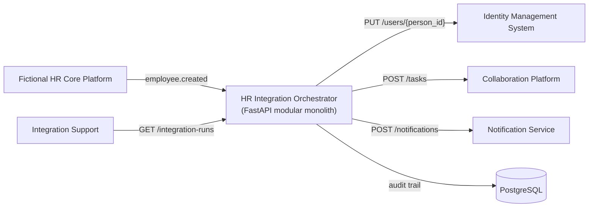
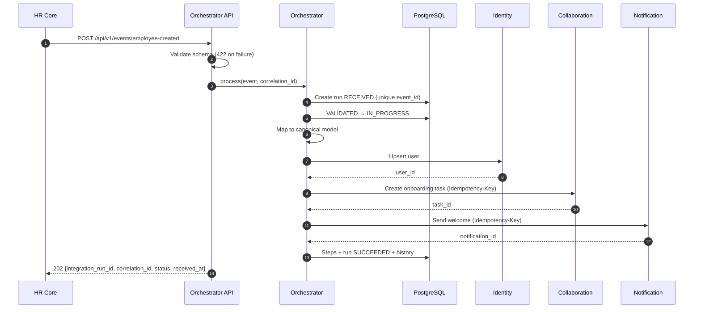

# HR Integration Orchestrator

A portfolio project showing how to build **reliable, observable, secure and testable enterprise integrations**. It covers a fictional HR employee-lifecycle scenario from the source contract to the audit trail.

> All systems, APIs, payloads, names and data in this repository are **fictional**. See the [disclaimer](#20-disclaimer).

---

## 1. Project purpose

Integration work usually goes wrong at the edges: duplicate events, flaky downstream systems, personal data leaking into logs, and failures nobody can trace. This repository shows how an integration consultant handles those concerns explicitly, with code, tests and documentation, instead of building a CRUD demo.

## 2. Business scenario

A fictional **HR Core Platform** emits an `employee.created` event when a new hire is registered. The orchestrator:

1. receives the event through REST and validates it against a strict schema,
2. maps it to a source-independent **canonical employee model**,
3. creates or updates the user in a fictional **Identity Management System**,
4. creates an onboarding task in a fictional **Collaboration Platform**,
5. sends a welcome message through a fictional **Notification Service**,
6. records a complete **audit trail** (run, steps, status history),
7. returns an integration run ID and status to the caller.

The design is ready for `employee.updated`, `employee.terminated` and `employee.cost_center_changed` ([extension strategy](docs/architecture.md#extension-strategy-for-additional-events)).

## 3. Key engineering capabilities demonstrated

- **Contract-first validation** with strict Pydantic models. Unknown fields are rejected, and error responses never echo input.
- **Canonical data model** with a documented [field-level mapping](docs/data-mapping.md).
- **Connector abstraction** (protocols + HTTP adapters) with consistent **error classification** into six categories.
- **Retry with capped exponential backoff** for transient errors only. Runs go to **manual review** after exhaustion.
- **Two-layer idempotency**: a unique `event_id` in the database plus idempotent downstream calls (upsert and `Idempotency-Key`).
- **Audit trail** of runs, steps, attempts and a timestamped status history, stored in PostgreSQL without PII.
- **Privacy-conscious structured logging**: JSON logs, correlation IDs and automatic email masking.
- **Failure simulation** to demonstrate and test operational scenarios.
- **Test suite** covering unit, connector (mocked HTTP) and end-to-end flows against in-process mock systems.
- **CI**: Ruff lint and format checks, pytest with coverage, Gitleaks secret scan and a Docker build.

## 4. Architecture diagram



Internal modules: `api` → `orchestration` → `domain` / `connectors` / `persistence`. More detail is in [docs/architecture.md](docs/architecture.md).

## 5. End-to-end sequence diagram



## 6. Technology stack

| Concern | Choice |
|---|---|
| Language / API | Python 3.12, FastAPI (generates OpenAPI and Swagger UI) |
| Validation | Pydantic v2, `pydantic-settings` for environment-based configuration |
| Persistence | SQLAlchemy 2.0, PostgreSQL 16 (SQLite in memory for tests) |
| HTTP client | HTTPX |
| Tests | Pytest, `pytest-cov`, `httpx.MockTransport`, FastAPI `TestClient` |
| Quality | Ruff (lint + format) |
| Runtime | Docker, Docker Compose |
| CI | GitHub Actions, Gitleaks |
| Diagrams | Mermaid |

Non-obvious dependencies:
- **`pydantic-settings`** reads configuration from environment variables with type validation.
- **`psycopg[binary]`** is the PostgreSQL driver used by SQLAlchemy (`postgresql+psycopg://`).
- **`uvicorn[standard]`** is the ASGI server.

## 7. Repository structure

```
.
├── app/
│   ├── api/              # routes, dependencies (correlation ID), PII-free response schemas
│   ├── connectors/       # protocols + HTTP adapters: identity, collaboration, notification
│   ├── domain/           # source event, canonical model, mapping, error taxonomy, statuses
│   ├── orchestration/    # EmployeeCreatedOrchestrator, RetryPolicy
│   ├── persistence/      # SQLAlchemy models, repository, engine/session
│   ├── config.py         # environment-based settings
│   ├── logging_config.py # JSON logging, email masking, correlation ID
│   ├── main.py           # application factory, error handlers
│   └── asgi.py           # uvicorn entrypoint
├── mock_services/        # LOCAL-ONLY mock downstream systems with failure simulation
├── tests/
│   ├── unit/             # validation, mapping, errors, retry, idempotency, logging, connectors
│   └── integration/      # end-to-end flows and failure scenarios
├── docs/                 # architecture, mapping, errors, security, runbook, ADRs
├── examples/             # sample fictional events
├── .github/workflows/ci.yml
├── docker-compose.yml, Dockerfile, Makefile, pyproject.toml, .env.example
└── LICENSE, CONTRIBUTING.md, CODE_OF_CONDUCT.md, SECURITY.md
```

## 8. Quick start using Docker Compose

Prerequisites: Docker with Compose v2. No `.env` file is required, because Compose uses the non-secret defaults.

```bash
docker compose up --build -d
curl -s http://localhost:8000/health
```

- API and Swagger UI: http://localhost:8000/docs
- OpenAPI JSON: http://localhost:8000/openapi.json
- Mock downstream systems: http://localhost:8100/docs

Without Docker (SQLite, mock systems in a second terminal):

```bash
python -m venv .venv && source .venv/bin/activate      # Windows: .venv\Scripts\activate
pip install -e ".[dev]"
uvicorn mock_services.app:app --port 8100 &
IDENTITY_SERVICE_BASE_URL=http://localhost:8100/identity \
COLLABORATION_SERVICE_BASE_URL=http://localhost:8100/collaboration \
NOTIFICATION_SERVICE_BASE_URL=http://localhost:8100/notification \
uvicorn app.asgi:app --port 8000
```

## 9. API usage examples using curl

**Success scenario**

```bash
curl -s -X POST http://localhost:8000/api/v1/events/employee-created \
  -H "Content-Type: application/json" \
  -H "X-Correlation-ID: demo-success-001" \
  -d @examples/employee-created.json
```

**Failure scenario 1: invalid employee event** (returns 422 and creates no run)

```bash
curl -s -X POST http://localhost:8000/api/v1/events/employee-created \
  -H "Content-Type: application/json" \
  -d @examples/employee-created-invalid.json
```

```json
{
  "error_category": "VALIDATION_ERROR",
  "message": "The request payload failed validation.",
  "correlation_id": "5b0c…",
  "details": [
    {"field": "employee.employee_id", "message": "String should match pattern '^EMP-\\d{5}$'"},
    {"field": "employee.work_email", "message": "String should match pattern '…'"},
    {"field": "employee.start_date", "message": "Field required"}
  ]
}
```

**Failure scenario 2: temporary identity timeout followed by a successful retry**

```bash
# Enable at runtime (or start Compose with SIMULATE_IDENTITY_TIMEOUT=true)
curl -s -X PUT http://localhost:8100/_simulation -H "Content-Type: application/json" \
  -d '{"identity_timeout": true, "identity_timeout_failures": 2}'

curl -s -X POST http://localhost:8000/api/v1/events/employee-created \
  -H "Content-Type: application/json" \
  -d '{"event_id":"evt-10002","event_type":"employee.created","occurred_at":"2026-09-24T11:00:00Z",
       "employee":{"employee_id":"EMP-10002","first_name":"Lucas","last_name":"Brandt",
       "work_email":"lucas.brandt@example.test","start_date":"2026-10-01","department":"Finance",
       "cost_center":"CC-200","location":"Utrecht","manager_employee_id":"EMP-00042"}}'
# -> status SUCCEEDED; run detail shows PROVISION_IDENTITY attempts=3, retry_count=2
```

**Failure scenario 3: permanent collaboration failure resulting in manual review**

```bash
curl -s -X PUT http://localhost:8100/_simulation -H "Content-Type: application/json" \
  -d '{"collaboration_failure": true}'

curl -s -X POST http://localhost:8000/api/v1/events/employee-created \
  -H "Content-Type: application/json" \
  -d '{"event_id":"evt-10003","event_type":"employee.created","occurred_at":"2026-09-24T11:05:00Z",
       "employee":{"employee_id":"EMP-10003","first_name":"Sofia","last_name":"Jansen",
       "work_email":"sofia.jansen@example.test","start_date":"2026-10-15","department":"People",
       "cost_center":"CC-300","location":"Amsterdam"}}'
# -> status MANUAL_REVIEW_REQUIRED, error_category PERMANENT_TECHNICAL_ERROR

curl -s "http://localhost:8000/api/v1/integration-runs?status=MANUAL_REVIEW_REQUIRED"
```

To see retry exhaustion, set `{"notification_failure": true}`. The notification step makes 4 attempts and the run ends in `MANUAL_REVIEW_REQUIRED`.

Reset the simulation with `curl -s -X PUT http://localhost:8100/_simulation -H "Content-Type: application/json" -d '{}'`.

**Operations**

```bash
curl -s http://localhost:8000/api/v1/integration-runs/<integration_run_id>
curl -s "http://localhost:8000/api/v1/integration-runs?status=FAILED"
curl -s http://localhost:8000/health
```

## 10. Example success response

`POST /api/v1/events/employee-created` → **202 Accepted**

```json
{
  "integration_run_id": "3f6c2a8e-5a4b-4f7e-9d0a-2c1b7e9f4a11",
  "correlation_id": "demo-success-001",
  "status": "SUCCEEDED",
  "received_at": "2026-09-24T10:30:01.120000Z",
  "duplicate": false
}
```

`GET /api/v1/integration-runs/{id}` (abridged). It contains no names or emails:

```json
{
  "integration_run_id": "3f6c2a8e-…",
  "correlation_id": "demo-success-001",
  "source_event_id": "evt-10001",
  "event_type": "employee.created",
  "status": "SUCCEEDED",
  "error_category": null,
  "error_message": null,
  "retry_count": 0,
  "received_at": "…", "started_at": "…", "finished_at": "…",
  "steps": [
    {"sequence": 1, "step_name": "MAP_TO_CANONICAL", "status": "SUCCEEDED", "attempts": 1, "external_reference": null},
    {"sequence": 2, "step_name": "PROVISION_IDENTITY", "status": "SUCCEEDED", "attempts": 1, "external_reference": "usr-1a2b3c4d5e6f"},
    {"sequence": 3, "step_name": "CREATE_ONBOARDING_TASK", "status": "SUCCEEDED", "attempts": 1, "external_reference": "tsk-…"},
    {"sequence": 4, "step_name": "SEND_WELCOME_NOTIFICATION", "status": "SUCCEEDED", "attempts": 1, "external_reference": "ntf-…"}
  ],
  "status_history": [
    {"status": "RECEIVED", "note": null, "occurred_at": "…"},
    {"status": "VALIDATED", "note": "Schema validation passed", "occurred_at": "…"},
    {"status": "IN_PROGRESS", "note": null, "occurred_at": "…"},
    {"status": "SUCCEEDED", "note": null, "occurred_at": "…"}
  ]
}
```

## 11. Error handling and retry strategy

| Category | Retried | Outcome |
|---|---|---|
| `VALIDATION_ERROR` | No | 422 at API (no run), or run `FAILED` |
| `BUSINESS_RULE_ERROR` | No | run `FAILED` |
| `AUTHENTICATION_ERROR` | No | `MANUAL_REVIEW_REQUIRED` |
| `PERMANENT_TECHNICAL_ERROR` | No | `MANUAL_REVIEW_REQUIRED` |
| `TRANSIENT_TECHNICAL_ERROR` | Yes | `MANUAL_REVIEW_REQUIRED` after exhaustion |
| `DEPENDENCY_UNAVAILABLE` | Yes | `MANUAL_REVIEW_REQUIRED` after exhaustion |

**Retry limit:** `RETRY_MAX_RETRIES=3` means at most 4 attempts per step, with backoff `0.5 s × 2^(n-1)` capped at `4 s`. Retries apply per step, so steps that already succeeded are not repeated. The demo executes retries synchronously ([ADR-003](docs/adr/003-synchronous-demo-retries.md)); the queue-and-worker production design is described there. Full details: [docs/error-handling.md](docs/error-handling.md).

## 12. Idempotency strategy

- `event_id` has a **unique constraint**. Resubmitting the same event returns the **existing run** (`"duplicate": true`) and makes **no** downstream calls.
- Downstream calls are idempotent on their own: Identity uses `PUT /users/{person_id}` (upsert), and Collaboration and Notification receive `Idempotency-Key: {event_id}:{step}`.
- Tests prove that three identical submissions produce exactly one user, one task and one notification.

See [ADR-002](docs/adr/002-idempotency-event-id.md).

## 13. Security and privacy considerations

- Raw payloads are never logged. Emails are masked by a logging filter (`maya.klein@example.test` → `m***@example.test`).
- Validation errors do not echo the submitted values.
- The audit database and status endpoints contain **no personal attributes**.
- Unknown input fields are rejected. Correlation IDs are validated against a safe pattern to prevent log injection.
- There are no secrets in the repository, CI runs Gitleaks, and the container runs as a non-root user.
- **Not implemented** (documented): inbound/outbound authentication, TLS, and role-based access to operations endpoints.

See [docs/security-and-privacy.md](docs/security-and-privacy.md).

## 14. Observability and operations

- **Structured JSON logs** with `timestamp`, `severity`, `logger`, `message`, `correlation_id`, `integration_run_id`, `event_id`, `step`, `attempt` and `error_category`. Field naming follows OpenTelemetry log conventions, so a collector can ingest the logs without code changes.
- **Correlation ID**: taken from `X-Correlation-ID` (or generated), returned in the response header and body, persisted on the run, and forwarded to every downstream call.
- **Operations API**: run detail, filtering by status, and `/health` with a database check.
- **Runbook**: [docs/operational-runbook.md](docs/operational-runbook.md), covering triage by category and replay guidance.

## 15. Testing

```bash
pip install -e ".[dev]"
pytest                                            # full suite
pytest --cov=app --cov-report=term-missing        # with coverage (or: make coverage)
```

| Area | File |
|---|---|
| Source-event validation | `tests/unit/test_source_event_validation.py` |
| Canonical mapping | `tests/unit/test_mapping.py` |
| Error classification | `tests/unit/test_error_classification.py` |
| Retry backoff | `tests/unit/test_retry_policy.py` |
| Idempotency (repository + orchestrator) | `tests/unit/test_idempotency.py` |
| Connectors with mocked HTTP | `tests/unit/test_connectors.py` |
| Email masking in logs | `tests/unit/test_log_masking.py` |
| Happy path, three failure scenarios, retry exhaustion, duplicates, PII-free endpoints and logs | `tests/integration/test_employee_created_flow.py` |

The integration tests run the real orchestrator API and real HTTP connectors against the mock downstream app in process. They use SQLite in memory, and retry sleeps are injected, so the suite runs in seconds with no external services.

## 16. CI/CD

`.github/workflows/ci.yml` runs on pushes to `main` and on pull requests:

1. **quality**: Python 3.12 setup, dependency install, `ruff check`, `ruff format --check`, and pytest with a coverage report (uploaded as `coverage-xml` artifact).
2. **secret-scan**: Gitleaks over the full git history (`.gitleaks.toml` allowlists the non-secret local defaults).
3. **docker-build**: builds the image and validates `docker-compose.yml`.

No credentials or external services are required. Deployment (CD) is intentionally out of scope.

## 17. Design decisions and trade-offs

| Decision | Trade-off |
|---|---|
| Modular monolith ([ADR-001](docs/adr/001-modular-monolith.md)) | Simple to run and test; all connectors scale together |
| Idempotency by `event_id` plus idempotent connectors ([ADR-002](docs/adr/002-idempotency-event-id.md)) | Safe resubmission; replaying a failed run requires a dedicated mechanism |
| Synchronous retries ([ADR-003](docs/adr/003-synchronous-demo-retries.md)) | Deterministic demo; request latency includes backoff |
| HTTP 500 treated as permanent | Conservative about repeating side effects; some outages go to manual review sooner |
| Schema-invalid events are not persisted | No PII-bearing garbage in the audit store; rejections are visible only in logs and in the caller's response |
| `create_all` instead of migrations | Zero-setup demo; production requires Alembic |
| One mock app for three systems | Minimal infrastructure; each system still has its own base URL, so real endpoints can be swapped in |

## 18. Known limitations

- There is no authentication on inbound or operations endpoints, and no TLS between containers.
- Retries block the request thread; there is no queue or worker yet.
- No replay endpoint exists; resubmitting the same `event_id` returns the existing run.
- Only `employee.created` is implemented, with no out-of-order protection (it is not needed for create events).
- There are no database migrations and no retention/purge job.
- There are no metrics or tracing exporters, only structured logs that are ready for an OpenTelemetry collector.
- Mock services store data in memory and reset on restart.

## 19. Planned extensions

- `employee.updated`, `employee.terminated` and `employee.cost_center_changed`, using the [documented extension strategy](docs/architecture.md#extension-strategy-for-additional-events)
- Queue-based workers with a dead-letter queue and a transactional outbox
- An operator replay endpoint that resumes from the first non-succeeded step
- OAuth2 client credentials for connectors, and inbound request signing
- Alembic migrations, a retention job, and OpenTelemetry traces and metrics
- Payload hashing to detect conflicting resubmissions under the same `event_id`

## 20. Disclaimer

This is an independent portfolio project. **All systems, APIs, payloads, organizations, names, email addresses and scenarios are fictional** and were created for demonstration purposes. The project does not use, reproduce or reference any proprietary product documentation, customer data, employer data or real personal data. Email addresses use the reserved `example.test` domain. Any resemblance to real persons or systems is coincidental.

Licensed under the [MIT License](LICENSE).

