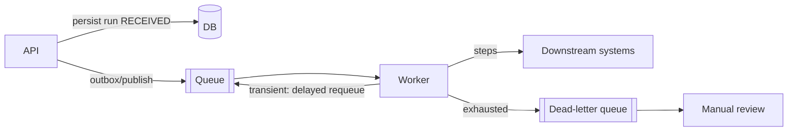

# ADR-003: Synchronous retries in the demo

- **Status:** Accepted (demo scope)
- **Date:** 2026-09-24

## Context

Retries with exponential backoff are required. A production-grade asynchronous design needs a message broker, a worker process and delayed redelivery. That infrastructure would dominate a portfolio project and make local runs and tests harder.

## Decision

Run the orchestration **synchronously within the request**. Retries use a bounded exponential backoff (default max 3 retries: 0.5 s, 1 s, 2 s). The endpoint still returns **202 Accepted**, with the final status in the body. The sleep function is injected, so tests verify the exact backoff sequence without waiting.

## Consequences

- Positive: deterministic behavior, simple demo, and tests cover the full flow end to end.
- Negative: request latency includes retry delays (worst case about 3.5 s per step). Callers with short timeouts might resubmit; this is safe thanks to ADR-002.
- The worker thread is blocked while it sleeps, which limits throughput under downstream outages.

## Production design

The `_execute` step logic and the error taxonomy move into the worker unchanged. Only the loop and sleep are replaced by broker redelivery.

