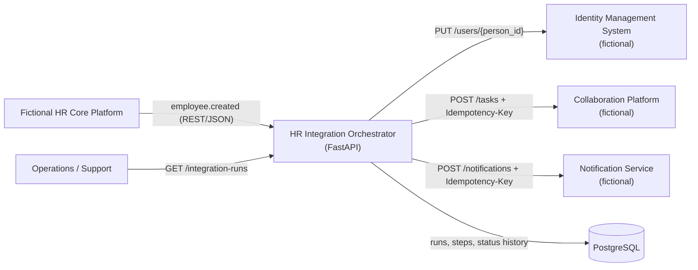
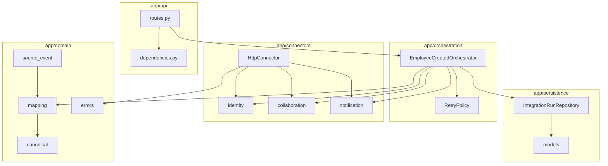
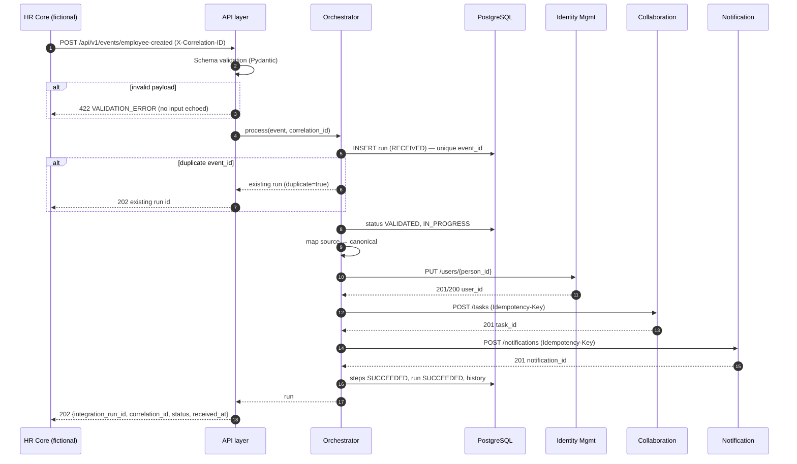
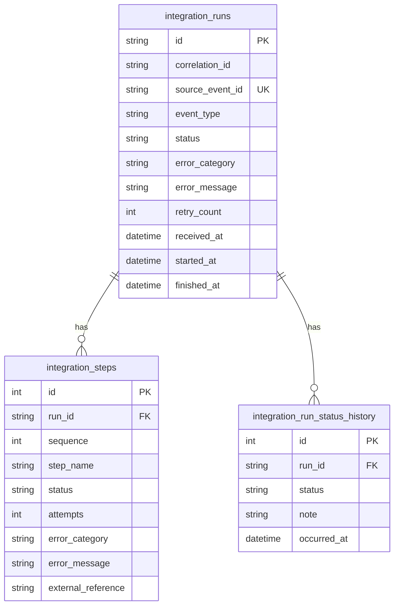

# Architecture

## Style

The orchestrator is a **modular monolith** ([ADR-001](adr/001-modular-monolith.md)): one deployable unit with strict internal boundaries.

| Module | Responsibility | Depends on |
|---|---|---|
| `app/api` | HTTP contract, correlation ID, error envelopes, PII-free response models | orchestration, persistence |
| `app/domain` | Source contract, canonical model, mapping, error taxonomy, statuses | – (pure Python/Pydantic) |
| `app/orchestration` | Flow control, step tracking, retry policy, final-status decisions | domain, connectors (interfaces), persistence |
| `app/connectors` | HTTP adapters for downstream systems; error classification | domain |
| `app/persistence` | SQLAlchemy models and repository for the audit trail | domain (statuses) |
| `mock_services` | **Local-only** fake downstream systems with failure simulation | – (never imported by `app`) |

The orchestrator depends on connector **protocols** (`IdentityConnector`, `CollaborationConnector`, `NotificationConnector`), so tests and future implementations can swap adapters without touching the flow.

## System context

## Component view

## End-to-end sequence

## Data model (audit)

No employee names, emails or other personal attributes are stored in these tables.

## Extension strategy for additional events

New lifecycle events (`employee.updated`, `employee.terminated`, `employee.cost_center_changed`) follow the same pattern:

1. **Contract**: add a Pydantic source model in `app/domain/source_event.py` (e.g. `EmployeeTerminatedEvent` with `event_type: Literal["employee.terminated"]`).
2. **Mapping**: reuse `CanonicalEmployee`; add partial/change models if the event carries deltas only.
3. **Steps**: declare a step list (e.g. `DEACTIVATE_IDENTITY`, `ARCHIVE_WORKSPACE`, `NOTIFY_MANAGER`).
4. **Connector methods**: extend the protocols (e.g. `IdentityConnector.deactivate_user`).
5. **Orchestrator**: add a dedicated orchestrator class, or refactor into a generic step-runner that receives a list of `(StepName, callable)`; the retry/step-tracking logic in `_execute` is already event-agnostic.
6. **Route**: either one route per event, or a single `POST /api/v1/events` with a discriminated union on `event_type`.
7. **Ordering**: for updates/terminations, compare `occurred_at` with the last processed event per `person_id` to reject stale events (out-of-order protection).

## Production evolution (not implemented)

- Accept event → persist → enqueue; process in a worker (see [ADR-003](adr/003-synchronous-demo-retries.md)).
- Transactional outbox for downstream calls; dead-letter queue feeding the manual-review process.
- Versioned DB migrations (Alembic) instead of `create_all`.
- OAuth2 client-credentials to downstream systems with secrets from a vault.

