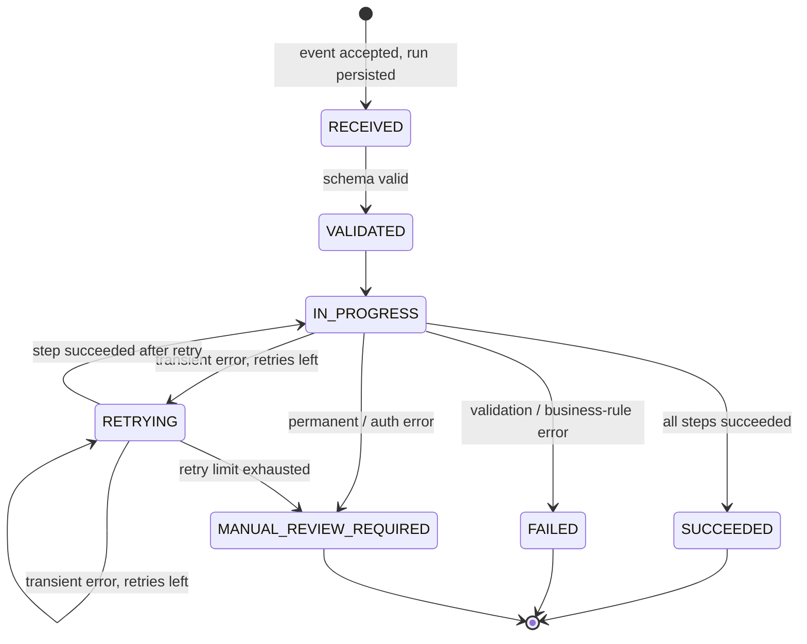
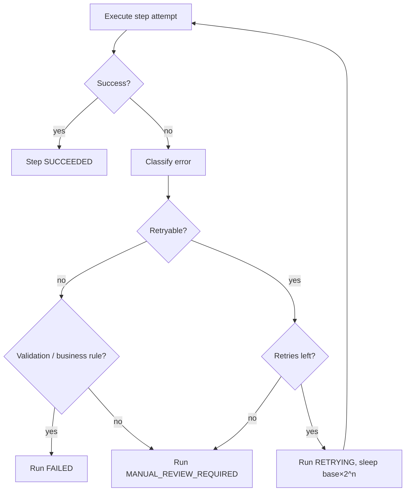

# Error Handling and Retry Strategy

## Error taxonomy

| Category | Typical cause | Retried? | Final run status |
|---|---|---|---|
| `VALIDATION_ERROR` | Schema violation (API 422) or downstream HTTP 400/422 | No | Rejected at API (no run) / `FAILED` |
| `BUSINESS_RULE_ERROR` | Rule violated (e.g. self-manager) or downstream HTTP 409 | No | `FAILED` |
| `AUTHENTICATION_ERROR` | Downstream HTTP 401/403 | No | `MANUAL_REVIEW_REQUIRED` |
| `TRANSIENT_TECHNICAL_ERROR` | Timeouts, HTTP 408/425/429/502/503/504 | **Yes** | `MANUAL_REVIEW_REQUIRED` after exhaustion |
| `DEPENDENCY_UNAVAILABLE` | Connection refused / network error | **Yes** | `MANUAL_REVIEW_REQUIRED` after exhaustion |
| `PERMANENT_TECHNICAL_ERROR` | HTTP 500/404/other, unexpected response body | No | `MANUAL_REVIEW_REQUIRED` |

Rationale:
- **FAILED** means *the source data must be corrected* – retrying or manual replay would not help.
- **MANUAL_REVIEW_REQUIRED** means *an operator must act* (fix configuration or credentials, contact the downstream owner, then replay). See the [runbook](operational-runbook.md).
- HTTP 500 is treated as permanent. Many teams retry 5xx broadly. This project is conservative so that non-idempotent side effects are not repeated on ambiguous server errors. Note that the connectors themselves are idempotent, so this is a policy choice.

Classification lives in `app/domain/errors.py` and is unit-tested per status code and exception type. Error messages stored in the audit trail are **safe, generic, PII-free strings** such as `"Collaboration Platform responded with HTTP 500."`. Downstream response bodies are never persisted.

## Retry policy

Configured by environment variables (`app/config.py`):

| Variable | Default | Meaning |
|---|---|---|
| `RETRY_MAX_RETRIES` | `3` | Retries after the initial attempt → **max 4 attempts per step** |
| `RETRY_BASE_DELAY_SECONDS` | `0.5` | Delay before retry *n* = `base × 2^(n-1)` |
| `RETRY_MAX_DELAY_SECONDS` | `4` | Cap per delay |

Default delays: 0.5 s → 1 s → 2 s. The worst case adds about 3.5 s per step.

Retries are per **step**. A step that succeeds is never repeated when a later step retries.

## Run and step state machine

Step statuses: `PENDING → IN_PROGRESS → (RETRYING)* → SUCCEEDED | FAILED`. Steps after a failed step become `SKIPPED`.

## Every transition is audited

Each status change appends a row to `integration_run_status_history` with a timestamp and a short note (for example `PROVISION_IDENTITY attempt 1 failed (TRANSIENT_TECHNICAL_ERROR); retrying in 0.50s`). This row is returned as `status_history` by the run-detail endpoint.

## Production evolution

In the demo, retries block the HTTP request ([ADR-003](adr/003-synchronous-demo-retries.md)). In production:
- The API persists the run and publishes a message, then returns `202` immediately with status `RECEIVED`.
- A worker consumes the message and executes steps. A transient failure re-queues the message with a delay (or uses broker-native delayed redelivery), adding jitter.
- After exhaustion, the message goes to a dead-letter queue and the run is marked `MANUAL_REVIEW_REQUIRED`.
- A replay endpoint re-enqueues a run from its first non-succeeded step. This is safe because connectors are idempotent.

